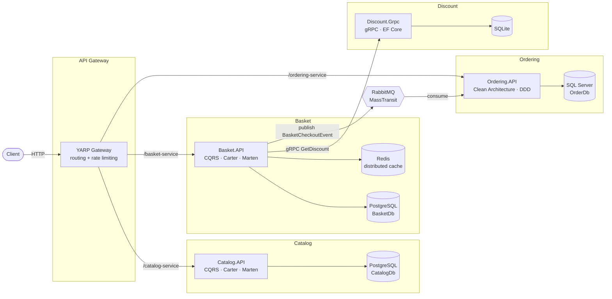
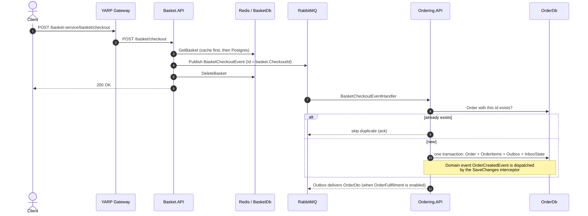
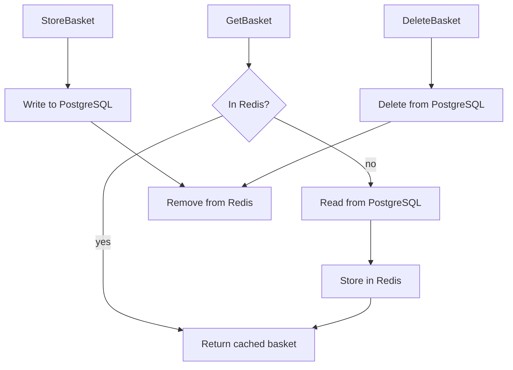
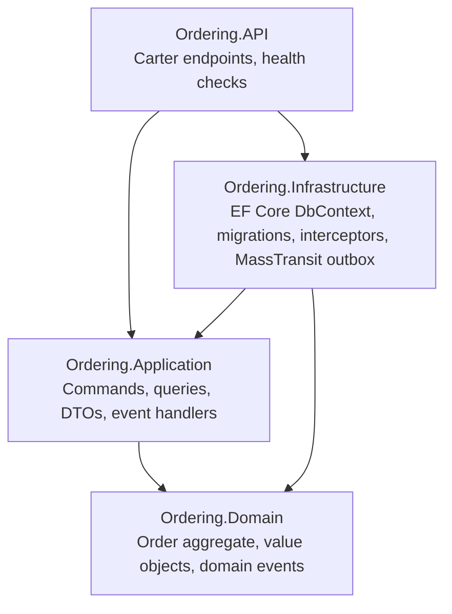

# eshop-microservices-architecture

An e-commerce backend built as .NET 10 microservices. Each service owns its own database. The services talk to each other over REST (through a YARP API gateway), gRPC and RabbitMQ.

## Architecture



| Service | Responsibility | Storage | Key patterns |
|---|---|---|---|
| **YarpApiGateway** | Single entry point, routes `/catalog-service`, `/basket-service`, `/ordering-service` | – | Reverse proxy, fixed-window rate limiter (5 requests / 10 s on ordering) |
| **Catalog.API** | Products CRUD, filter by category | PostgreSQL (Marten document DB) | Vertical slices, CQRS with MediatR, FluentValidation pipeline |
| **Basket.API** | Shopping cart, checkout | PostgreSQL (Marten) + Redis | Cache-aside decorator (Scrutor), gRPC client, event publisher |
| **Discount.Grpc** | Coupons per product | SQLite (EF Core) | gRPC server |
| **Ordering.API** | Orders | SQL Server (EF Core) | Clean Architecture, DDD aggregates, domain events, transactional outbox |

## Checkout flow

A checkout goes from Basket to Ordering asynchronously. Both sides are built so the same checkout can never create two orders.



- **Idempotency:** `CheckoutId` changes every time the basket is stored. Ordering uses it as the order Id, so a repeated checkout (for example after a failed delete) is detected and skipped.
- **Transactional outbox:** MassTransit's EF Core outbox saves outgoing messages in the same SQL Server transaction as the order, so an order is never saved without its event.
- **Retry:** consumers retry after 100 ms, 500 ms and 1 s before a message goes to the error queue.

## Basket caching



- Keys are `basket:{userName}`.
- Expiry: 30 min sliding, 120 min absolute (`CacheSettings` in `appsettings.json`).
- If Redis is down, the repository logs a warning and serves from PostgreSQL.

## Ordering: Clean Architecture



Dependencies point inward: `Ordering.Domain` references nothing. `Ordering.Application` defines `IApplicationDbContext`, and `Ordering.Infrastructure` implements it.

## Running locally

### docker-compose (Podman or Docker)

From `src/`:

```bash
docker compose -f docker-compose.yml -f docker-compose.override.yml up -d --build
```

| Container | URL |
|---|---|
| YARP gateway | http://localhost:6004 |
| Catalog.API | http://localhost:6000 |
| Basket.API | http://localhost:6001 |
| Discount.Grpc | http://localhost:6002 |
| Ordering.API | http://localhost:6003 |
| RabbitMQ management | http://localhost:15672 (guest / guest) |

### Visual Studio (https profiles)

Start the databases, Redis and RabbitMQ from docker-compose, then run the services with their `https` launch profiles:

| Service | URL |
|---|---|
| YARP gateway | https://localhost:5054 |
| Catalog.API | https://localhost:5050 |
| Basket.API | https://localhost:5051 |
| Discount.Grpc | https://localhost:5052 |
| Ordering.API | https://localhost:5053 |

## Endpoints (through the gateway)

| Method | Path | Description |
|---|---|---|
| GET | `/catalog-service/products` | List products (paged) |
| GET | `/catalog-service/products/{id}` | Product by id |
| GET | `/catalog-service/products/category/{category}` | Products by category |
| POST / PUT | `/catalog-service/products` | Create / update product |
| DELETE | `/catalog-service/products/{id}` | Delete product |
| GET | `/basket-service/basket/{userName}` | Get basket |
| POST | `/basket-service/basket` | Store basket (applies discounts via gRPC) |
| DELETE | `/basket-service/basket/{userName}` | Delete basket |
| POST | `/basket-service/basket/checkout` | Checkout, publishes `BasketCheckoutEvent` |
| GET | `/ordering-service/orders` | List orders (paged) |
| GET | `/ordering-service/orders/{orderName}` | Orders by name |
| GET | `/ordering-service/orders/customer/{customerId}` | Orders by customer |
| POST / PUT | `/ordering-service/orders` | Create / update order |
| DELETE | `/ordering-service/orders/{id}` | Delete order |

Catalog, Basket and Ordering also expose `GET /health`, which checks their databases (and Redis for Basket).

## Tech stack

.NET 10 · ASP.NET Core minimal APIs · Carter · MediatR · FluentValidation · Mapster · Marten · EF Core (SQL Server, SQLite) · gRPC · MassTransit 8 · RabbitMQ · Redis · YARP · Scrutor · Microsoft.FeatureManagement
